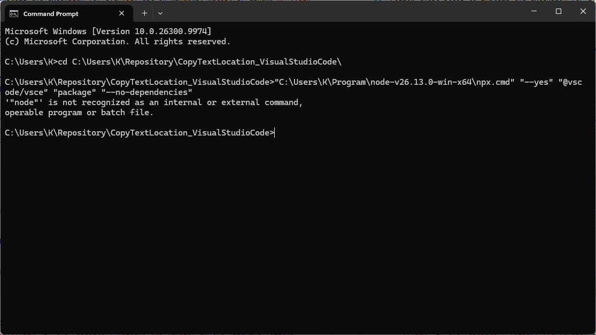

# Node Not Recognized

User and assistant messages are reproduced verbatim. Tool calls and tool outputs are omitted. The attached image is preserved below.

## user

i get this error: "C:\Users\K\Pictures\Screenshots\Screenshot 2026-11-11 083502.png"



## assistant

Found it: the failure comes from the `vsce` launcher that npx downloads, not from `npx.cmd`. That launcher calls plain `node`, so Node's folder has to be on PATH. Next I'll reproduce the error and then test the fix.

## assistant

Reproduced it, and the fix works. Without Node on PATH I get the same `'"node"'` error. With Node's folder added to PATH, the same command packages the extension successfully. Next I'll check how earlier conversations were recorded so I can record this one the same way.

## assistant

Earlier logs use `## user` / `## assistant` sections, and attached images are copied next to the log. I'll record this one that way and commit only the conversation files. Your own README edits stay uncommitted.

## assistant

The error comes from the packaging tool, not from `npx.cmd`. `npx.cmd` finds the `node.exe` beside it, but the `vsce` launcher it downloads runs plain `node`. So does the build step (`npm run vscode:prepublish`) that vsce starts. Your Node folder isn't on PATH, so calling `npx.cmd` by its full path isn't enough.

**Fix:** add the folder to PATH in that window first, then run the normal command.

In Command Prompt (what your screenshot shows):

```cmd
set "PATH=C:\Users\K\Program\node-v26.13.0-win-x64;%PATH%"
```

```cmd
npx --yes @vscode/vsce package --no-dependencies
```

In PowerShell (the VS Code terminal's default):

```powershell
$env:Path = "C:\Users\K\Program\node-v26.13.0-win-x64;$env:Path"
```

```powershell
npx.cmd --yes @vscode/vsce package --no-dependencies
```

This lasts only for that window. To avoid repeating it, add the folder to your user PATH and restart VS Code.

I checked both cases in Command Prompt. Without Node on PATH, I got your exact `'"node"' is not recognized` error. With the folder on PATH, the build ran and vsce produced a valid VSIX. I wrote that VSIX to a scratch folder, so the repo only gained the Git-ignored `Build/` folder.

The two full-path `npx` lines you added to `README.md` fail for the same reason. I didn't touch your README edits, and they're still uncommitted. I recorded this conversation and your screenshot in [Conversations/NodeNotRecognized.md](Conversations/NodeNotRecognized.md) and committed only those two files.
